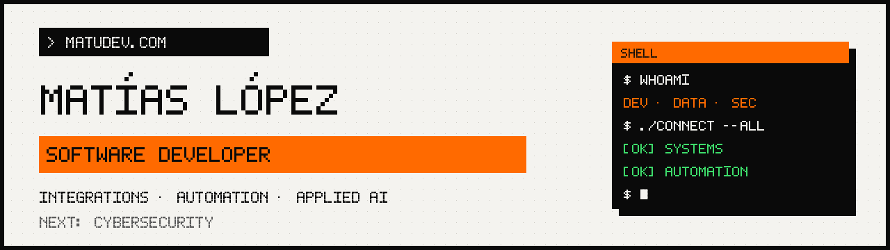

<div align="center">



### Software developer building integrations, automation and data systems — on the way to security engineering.

[](https://www.matudev.com/)
[](https://www.linkedin.com/in/lopez-matias/)
[](mailto:lopeznunezmati@gmail.com)

</div>

---

## 01 / WHOAMI

```yaml
name: Matías López
role: Software Developer
location: Montevideo, Uruguay  # remote, Latin America
education: Computer Engineering @ Universidad de la República (in progress)
experience: 4+ years · ERP, data warehouses, ETL, BI
building:
  - Backend services and REST APIs (Python, Java, Node.js)
  - System integrations: ERP ↔ e-commerce ↔ CRM ↔ spreadsheets
  - Automation & ETL pipelines with monitoring and alerting
  - Applied AI on business data (LLM APIs and local models)
heading_to:
  - Software engineering: architecture, testing, scalability
  - Cybersecurity: networking, Linux hardening, web app security
```

I've spent 4+ years inside business systems — large-scale retail, trade and distribution, and multi-branch commerce — working on databases, data warehouses, OLAP cubes, ETL pipelines and ERP integrations on Linux and Windows Server.

Today I build software that connects those systems and removes manual work. Next, I'm growing into **security engineering**: I already work with access control, log pipelines (Elasticsearch/Kibana) and Linux servers, and I'm training hands-on in networking, hardening and web application security (started with Cisco's *Introduction to Cybersecurity*, 2025).

---

## 02 / PROJECTS.DIR

<table>
  <tr>
    <td width="55%" valign="top">
      <h3>CuentaClara</h3>
      <p><b>Personal finance web app · live</b></p>
      <p>
        <code>Web App</code>
        <code>Supabase</code>
        <code>PostgreSQL</code>
        <code>Responsive UI</code>
      </p>
      <p>
        Consolidates transactions, expenses and balances from several accounts into a single view,
        with automatic categories and summaries. Designed, built and maintained end to end.
      </p>
      <p><a href="https://cuentaclara.matudev.com"><b>Live app ↗</b></a></p>
    </td>
    <td width="45%" valign="top">
      <h3>matudev.com</h3>
      <p><b>Portfolio &amp; services site</b></p>
      <p>
        <code>HTML/CSS/JS</code>
        <code>Vercel Functions</code>
        <code>Node test runner</code>
      </p>
      <p>
        Framework-free, bilingual site with a custom pixel font, strict CSP headers,
        a rate-limited contact API and automated content tests.
      </p>
      <p><a href="https://www.matudev.com"><b>Live site ↗</b></a> · <a href="https://github.com/lopez-matias/personal_landing">Source ↗</a></p>
    </td>
  </tr>
</table>

---

## 03 / SERVICES.DB

<table>
  <tr>
    <td width="33%" valign="top">
      <h3>Systems integration</h3>
      E-commerce, marketplaces, ERP, invoicing and supplier APIs — stock, prices and orders in sync.
      <br/><br/><b>From USD 800</b>
    </td>
    <td width="33%" valign="top">
      <h3>Process automation</h3>
      Scheduled reports, reconciliation, failure and low-stock alerts, automatic data loading.
      <br/><br/><b>From USD 350</b>
    </td>
    <td width="33%" valign="top">
      <h3>Applied AI &amp; CRM</h3>
      Assistants on real catalog data, leads routed into HubSpot or Salesforce, PDF invoice extraction.
      <br/><br/><b>From USD 900</b>
    </td>
  </tr>
</table>

**How it works:** free 30-minute assessment → proposal within 12–24 h → delivery in ~2 weeks (depending on scope) → **6-month warranty** on everything delivered → optional monthly plan (USD 150 / 350 / 700).

---

## 04 / STACK.INI

🟧 production · ⬜ learning

| Area | Tools |
| --- | --- |
| **Languages** |      |
| **Backend & APIs** |        |
| **Integration targets** |        |
| **Automation & ETL** |         |
| **Data & BI** |        |
| **Applied AI** |      |
| **Infra & DevOps** |         |
| **Security** |         |

---

## 05 / EXPERIENCE.LOG

```text
[large-scale retail]      Data, BI & databases
                          DWH · SSAS cubes · ETL on Linux · alerting · query tuning
[trade & distribution]    Data analysis & automation
                          Python · Power Automate · VBA · reporting pipelines
[multi-branch commerce]   ERP development & DBA
                          stock · invoicing · inventory · schema redesign
```

---

## 06 / ROADMAP.MD

```text
[now]   Integrations, automation and applied AI for Latin American companies
[next]  Software engineering  → architecture, testing, observability
[next]  Cybersecurity          → networking, Linux hardening, OWASP Top 10, log analysis
[lab]   Home lab with VMs for offensive/defensive practice
```

---

## 07 / CONTACT.API

<div align="center">

### Which process takes your team the most time?

Tell me which systems you use and what you do by hand today — I'll reply within 24 hours.

**Remote across Latin America · Spanish · English (written)**

[](https://www.matudev.com/)
[](https://www.linkedin.com/in/lopez-matias/)
[](mailto:lopeznunezmati@gmail.com)

<sub>Software development · Integrations · Automation · Security — matudev.com</sub>

</div>
